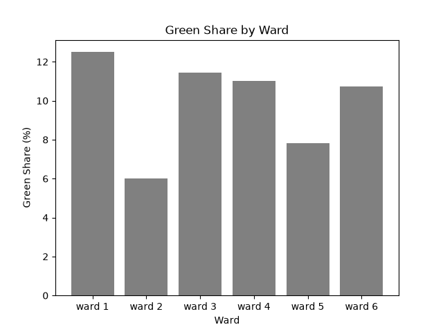

# Ward Summary Tool

A small Python script that calculates population density and green share for city wards, prints a summary, and draws a bar chart. Built as a Stage 1 practice project while learning Python for GIS.

## Question

Which wards are the most densely populated, and how much green space does each ward have?

## Data

Made-up practice numbers for 6 wards (population, ward area in km2, green area in km2). These are **not real data**.

## Method

Python with pandas and matplotlib:

1. Build a table (DataFrame) from a dictionary of lists.
2. `add_indicators()` adds two columns:
   - density = population / area (people per km2)
   - green share = green area / ward area x 100 (%)
3. `summarize()` returns total population, mean density, maximum density and mean green share.
4. `idxmax()` finds the ward with the highest density.
5. A bar chart of green share by ward is saved as a PNG image.

## Result

In this practice data:

- Total population: 656,168
- Mean ward density: 25,117.6 people per km2
- Highest density: ward 5 (33,729.4 people per km2)
- Mean green share: 9.9%

| Ward | Density (people per km2) | Green share (%) |
|------|--------------------------|-----------------|
| ward 1 | 11,857.9 | 12.5 |
| ward 2 | 21,826.9 | 6.0 |
| ward 3 | 29,032.0 | 11.4 |
| ward 4 | 31,514.6 | 11.0 |
| ward 5 | 33,729.4 | 7.8 |
| ward 6 | 22,745.0 | 10.7 |

Ward 5 is the densest ward but has one of the lowest green shares (7.8%). Ward 2 has the lowest (6.0%).



## Limits

- The data is made up, so the results say nothing about real wards.
- Only 6 wards, with no maps or spatial analysis yet.
- "Green area" is a single given number. It is not measured from land cover or NDVI.
- Mean density is a simple average of ward values. It is not the same as total population divided by total area.

## How to run

```
pip install -r requirements.txt
python ward_summary.py
```

The script prints the ward table and summary, and saves `ward_summary_green_share.png`.

## Files

- `ward_summary.py`: the script
- `requirements.txt`: libraries needed to run it
- `ward_summary_green_share.png`: the chart the script saves
- `.gitignore`: files Git should not upload (environments, keys, private data)

## Author

Aditya Dutta (GitHub: aditya-geo)